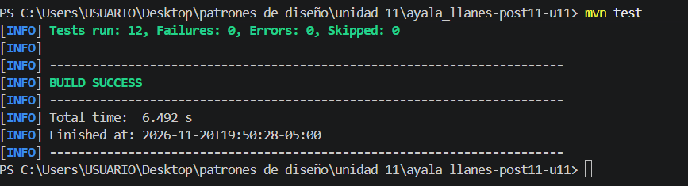
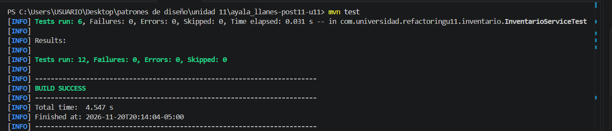
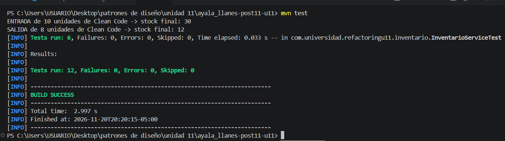
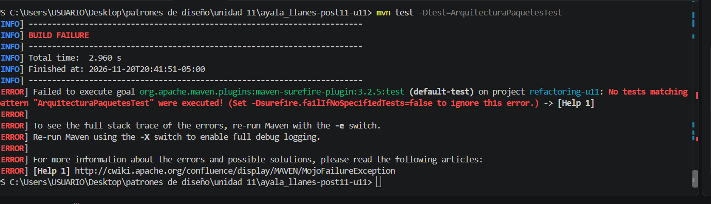
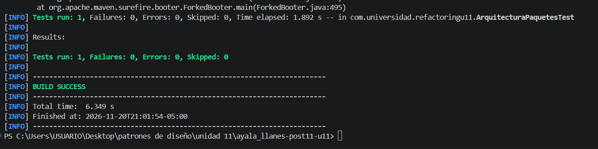
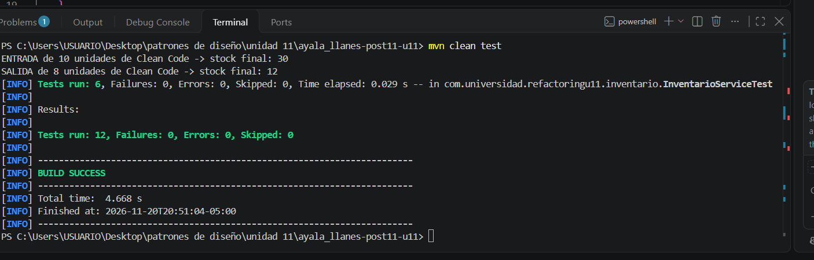

apellido-post1-u11 — Refactorización Guiada por Pruebas

Post-contenido Unidad 11 · Patrones de Diseño de Software. Proyecto Maven (Java 17, Spring Boot) con dos partes: Parte 1 (code smells + pruebas de caracterización) y Parte 2 (acoplamiento entre paquetes).

Nombre: Abel Stiven Ayala Llanes · Código: 1152354

Parte 1 — Red de seguridad y refactorización guiada por evidencia
1. Flujo seguido (historial de commits)
#	Commit	Propósito
1	feat: crear inventario con Long Method...	Código original con los dos smells
2	test: agregar pruebas de caracterizacion...	Red de seguridad escrita antes de tocar el código
3	refactor: eliminar Long Method...	Descomposición de actualizarInventario()
4	refactor: eliminar switch duplicado...	Polimorfismo sobre TipoProducto

Las 3 clases de prueba (InventarioServiceTest, ClasificadorProductoTest, EtiquetadoProductoTest; 12 pruebas) no se modificaron después del commit 2.

2. Smell 1 — Long Method en InventarioService.actualizarInventario()

Evidencia antes

Longitud del método: 44 líneas (de la firma a la llave de cierre).
Responsabilidades mezcladas: 6 (validación de entrada, búsqueda del producto, actualización de stock, cálculo de reorden, registro/auditoría y alerta/notificación).
Complejidad ciclomática aproximada (conteo manual de if, for, ?:, &&, ||): ≈ 12. Verificar con la métrica de IntelliJ y ajustar si difiere.
Cobertura antes de las pruebas de caracterización: 0 %.

Técnica elegida (Fowler): Extract Method (composición de métodos), aplicada de a una extracción por vez ejecutando mvn test entre cada una.

Evidencia después

actualizarInventario(): 10 líneas en total (firma + 8 de cuerpo + llave de cierre), ≤ 10 exigidas.
Complejidad ciclomática aproximada del método principal: ≈ 5.
Métodos extraídos, cada uno con una sola responsabilidad: sonDatosValidos, buscarProducto, aplicarMovimiento, necesitaReorden, calcularCantidadReorden, registrarMovimiento, alertarBajoStock. Los literales "ENTRADA", "SALIDA" y el factor 3 pasaron a constantes.
Comportamiento preservado, incluyendo casos límite (p. ej. el orden de los mensajes impresos y que la validación de stock negativo solo aplique a SALIDA).
Decisión de diseño 1 — Cálculo de reorden: método privado vs. clase colaboradora

Elección: método privado (calcularCantidadReorden) dentro de InventarioService.

Justificación: la regla es una sola expresión (stockMinimo × 3 − stock), estable y con un único punto de uso; no tiene hoy una razón de cambio distinta de la del servicio. Crear CalculadoraReorden añadiría una clase, su cableado y más indirección sin beneficio actual (se pagaría complejidad por un cambio hipotético). Criterio de reevaluación: si aparecen políticas de reorden por tipo de producto o por proveedor, o se necesita probar la regla de forma aislada, se extrae a su propia clase (Extract Class), pues pasaría a tener razón de cambio propia (SRP). El factor 3 quedó como constante nombrada para facilitar ese paso.

3. Smell 2 — Switch Statements duplicados

Evidencia antes

ClasificadorProducto.calcularRecargoEnvio y EtiquetadoProducto.generarEtiqueta contenían el mismo switch sobre TipoProducto con las mismas 4 ramas: 8 case en total (grep -c "case " → 4 + 4), más 2 default: throw repetidos. Agregar un tipo obligaba a editar 2 clases.

Técnica elegida (Fowler): Replace Conditional with Polymorphism, usando un enum con cuerpo por constante (método abstracto calcularRecargoEnvio implementado en cada constante; la etiqueta se parametriza con prefijo y nota por constante).

Evidencia después

grep -rn "switch\|case " src/main → 0 coincidencias. No queda ningún switch ni cadena if-else sobre el tipo.
Las firmas calcularRecargoEnvio(Producto) y generarEtiqueta(Producto) se conservan; ahora cada una es una sola línea que delega en el tipo.
Agregar un tipo nuevo = agregar una constante a TipoProducto; ClasificadorProducto y EtiquetadoProducto no se tocan. Además el compilador obliga a implementar el recargo de la nueva constante (método abstracto).
Decisión de diseño 2 — Enum con método abstracto vs. interfaz de estrategia

Elección: enum con comportamiento por constante.

Justificación: el conjunto de tipos es cerrado y estable en este dominio, y la información (recargo y etiqueta) vive junto a cada tipo, en un único archivo, sin jerarquía adicional ni mapa de registro. La alternativa (interfaz EstrategiaProducto + una clase por tipo + resolución de la estrategia) cuesta 4–5 clases más y solo compensa si cada tipo necesitara colaboradores inyectados por Spring o si los tipos se agregaran dinámicamente (p. ej. desde base de datos). Costo aceptado: el enum no puede recibir dependencias inyectadas; si ese requisito aparece, se migra a estrategia manteniendo las firmas públicas de ClasificadorProducto y EtiquetadoProducto.

4. Resultado de mvn test

Antes de refactorizar (commit 2, código original):

Después del refactor del Long Method (commit 3):

Después del refactor del switch (commit 4):

Parte 2 — Diagnóstico y resolución de acoplamiento entre paquetes
5. Diagnóstico: ciclo inventario ⇄ reportes

Se agregó el paquete reportes (ReporteBajoStockService). Para que inventario notifique el bajo stock, InventarioService importó ReporteBajoStockService, mientras que este ya importaba InventarioService. El proyecto compila y todas las pruebas de negocio de la Parte 1 siguen en verde (el guard != null evita el NPE porque las pruebas instancian el servicio sin colaborador): el problema es de arquitectura, no de comportamiento.

Diagrama de paquetes — ANTES (con ciclo)

InventarioService importaReporteBajoStockService
ReporteBajoStockServiceimporta InventarioService
inventario
reportes
 +------------+  ---- importa ReporteBajoStockService ---->  +----------+
 | inventario |                                              | reportes |
 +------------+  <---- importa InventarioService -----------  +----------+
                         (CICLO)

Evidencia: ArquitecturaPaquetesTest en rojo

6. Resolución: inversión de dependencias

Se extrajo la interfaz NotificadorBajoStock en el paquete inventario. InventarioService depende solo de esa abstracción (ya no importa nada de reportes) y ReporteBajoStockService la implementa, de modo que la única dirección de dependencia es reportes → inventario.

Diagrama de paquetes — DESPUÉS (sin ciclo)

implementaNotificadorBajoStock, usaProducto
reportes
inventario
 +----------+  --- implementa NotificadorBajoStock / usa Producto --->  +------------+
 | reportes |                                                          | inventario |
 +----------+                                                          +------------+
        (una sola dirección: reportes -> inventario)

ReporteBajoStockService ya no mantiene una referencia a InventarioService: nunca la usaba (quedaría como campo sin uso) y solo necesita los datos del evento que recibe en notificar. Su dependencia con inventario se mantiene a través de NotificadorBajoStock y Producto. Efecto lateral positivo: al no existir tampoco el ciclo entre beans, Spring puede arrancar sin referencias circulares.

Evidencia: ArquitecturaPaquetesTest en verde

grep -rn "import .*reportes" src/main/java/com/universidad/refactoringu11/inventario → sin resultados (el paquete inventario no importa reportes).

Decisión de diseño 3 — Ubicación de NotificadorBajoStock en inventario

La interfaz vive en inventario y no en reportes. Siguiendo la regla "los paquetes de infraestructura dependen de dominio; dominio nunca depende de infraestructura" (Guía de Contenido, 4.3), inventario es el paquete de mayor nivel de abstracción: contiene el modelo y las reglas del negocio (stock, reorden), mientras que reportes es un consumidor/detalle de presentación que puede cambiar o reemplazarse (correo, log, otro formato) sin afectar al dominio. Quien necesita la capacidad ("avisar de un bajo stock") es el dominio, así que él define el contrato (puerto) y lo posee; el paquete de bajo nivel se adapta implementándolo. Si la interfaz estuviera en reportes, inventario seguiría importando reportes y el ciclo persistiría.

Decisión de diseño 4 — notificar(Producto, int) por evento vs. por lote

Elección: notificación por evento. actualizarInventario() procesa un movimiento a la vez y detecta el bajo stock en ese instante: notificar por evento mantiene el contrato alineado con ese flujo, sin que el dominio tenga que acumular productos ni decidir cuándo "cerrar" un lote; el receptor se entera inmediatamente y la interfaz es mínima (un método, una responsabilidad), fácil de implementar y de probar con un doble. Además notificar(List<Producto>) obligaría a pasar la lista de cantidades de reorden por separado o a crear un tipo nuevo. Preferiría lote en escenarios de alto volumen o de costo alto por notificación (envío masivo de correos, escritura de un archivo de reporte consolidado, llamadas a servicios externos con límite de tasa), o en un proceso batch/programado (cierre del día) donde interesa consolidar y deduplicar alertas antes de enviarlas.

7. Confirmación de que el comportamiento no cambió

Tras la reestructuración se ejecutó la suite completa sin modificar InventarioServiceTest, ClasificadorProductoTest ni EtiquetadoProductoTest:

    (esperado: 13 pruebas = 12 de caracterización + 1 de arquitectura; todas en verde) >>>
8. Estructura final
src/main/java/com/universidad/refactoringu11/
├── RefactoringU11Application.java
├── inventario/
│   ├── TipoProducto.java            (enum con comportamiento por constante)
│   ├── Producto.java
│   ├── InventarioService.java       (actualizarInventario descompuesto)
│   ├── ClasificadorProducto.java
│   ├── EtiquetadoProducto.java
│   └── NotificadorBajoStock.java    (abstracción propiedad del dominio)
└── reportes/
    └── ReporteBajoStockService.java (implementa NotificadorBajoStock)